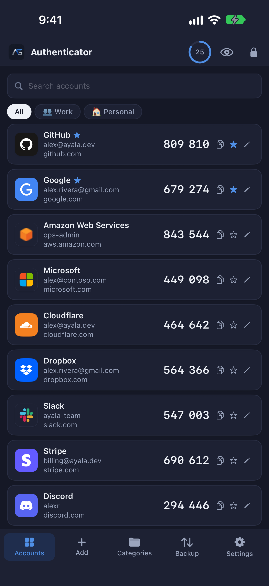
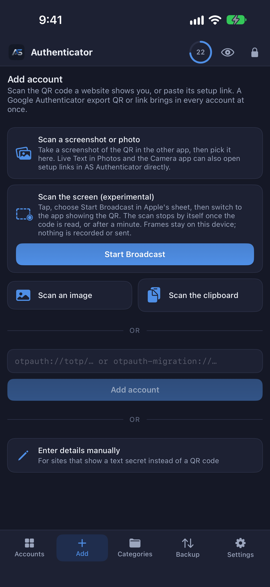
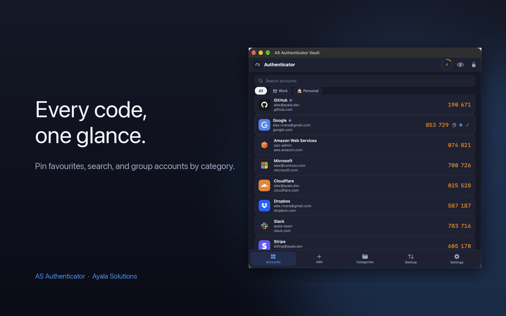

# AS Authenticator Vault

Two-factor codes, encrypted on your device and nowhere else. One native app for **iPhone, iPad and Mac**, by Ayala Solutions.

- **iOS and iPadOS 18 or later**, including AutoFill of codes above the keyboard
- **macOS 15 or later**, Apple silicon and Intel, with a menu bar extra and on-screen QR scanning
- Optional sync between your devices through your own iCloud account, ciphertext only
- No account, no server, no analytics, no tracking

[Privacy policy](https://hov172.github.io/as-authenticator-vault/privacy) · [Support](https://hov172.github.io/as-authenticator-vault/support) · [Browser extension](https://github.com/hov172/AS-Authenticator-Browser-Extensions) that opens the same vault file

> Version 1.2 is in App Review for both platforms. The App Store link will be `https://apps.apple.com/app/id6821787531` once it is live.

&nbsp;
&nbsp;

## What it does

| | iPhone and iPad | Mac |
| --- | :-: | :-: |
| TOTP (SHA-1/256/512, 6 to 8 digits, any period), HOTP, Steam Guard | ✓ | ✓ |
| Unlock with Face ID, Touch ID or your master password | ✓ | ✓ |
| Codes above the keyboard through AutoFill, matched to the site | ✓ | |
| Menu bar extra, ⌘L to lock, ⌘N to add, ⌘F to search | | ✓ |
| Scan a QR code with the camera | ✓ | ✓ |
| Scan a QR code shown in any window or display | | ✓ |
| Scan a QR code from a photo, a file or the clipboard | ✓ | ✓ |
| Hand-off from Camera, Safari and Live Text | ✓ | |
| Google Authenticator migration QR, all accounts at once | ✓ | ✓ |
| Import from Aegis, 2FAS, Bitwarden and otpauth lists | ✓ | ✓ |
| Export an encrypted vault file the browser extension opens unchanged | ✓ | ✓ |
| Five automatic local backups, recovery code, password change | ✓ | ✓ |
| Sync between devices through iCloud (off by default) | ✓ | ✓ |
| Over 3,000 recognisable service logos, offline | ✓ | ✓ |
| Auto-lock on inactivity, screen lock, or leaving the app | ✓ | ✓ |
| Privacy screen in the app switcher | ✓ | |
| English, German, Spanish, French, Brazilian Portuguese | ✓ | ✓ |

Every account that arrives from a link, a scan or an import is shown in a review sheet first. Nothing is written to the vault until you tap Add.

## How your secrets are protected

- The vault is a single file encrypted with **AES-256-GCM** under a key derived from your master password with **Argon2id** (64 MiB, 3 passes). The same file format as the browser extension, so one export opens in both.
- Biometric unlock wraps the master password with a key in the device's **Secure Enclave**, bound to the current Face ID or Touch ID enrolment. A changed enrolment asks for the password once.
- The iOS AutoFill extension never derives keys. It reads a session cache the app writes after a biometric unlock.
- Copied codes are local-only, never reach Universal Clipboard, and the clipboard clears itself after 30 seconds.
- Exports, backups and synced copies are always the encrypted file. Your master password never leaves the device.

## Sync between your devices

Off by default. Turn it on in Settings and pick one of three methods, all through your own iCloud account:

| Method | Transport | How changes arrive |
| --- | --- | --- |
| iCloud Drive | one file in the app's iCloud container | file-change notifications plus polling |
| iCloud Keychain | one synchronizable Keychain item | polling |
| iCloud (CloudKit) | one record in the app's private database | silent push plus polling |

What is stored in iCloud is the encrypted vault plus a revision number, a timestamp and a device tag such as `iPhone-3f9a2c1b`, never your device name. Apple holds only ciphertext. iCloud Keychain is end-to-end encrypted by Apple; iCloud Drive and CloudKit are end-to-end encrypted when Advanced Data Protection is on for your Apple Account, and otherwise the vault's own encryption is what protects your secrets. A vault without a master password never syncs. **Remove synced copies from iCloud** in Settings deletes the copy from all three places.

A fresh install only needs a vault of its own and the same sync method selected. If the master password differs, the app shows which device the synced vault came from and when, and takes that vault and its password only when you enter it.

## What the app sends

Nothing, unless you turn on one of two optional features in Settings: a once-an-hour time check against timeapi.io to correct clock drift, and site icons fetched once over HTTPS from a site you have an account with. Each has its own switch and is explained in the app. There is no server of ours, no account system, no analytics, no crash reporting and no advertising.

## Source

The app's source is private. The browser extension that shares its vault format is open source at [hov172/AS-Authenticator-Browser-Extensions](https://github.com/hov172/AS-Authenticator-Browser-Extensions). Bug reports and questions about the app are welcome in [this repository's issues](https://github.com/hov172/as-authenticator-vault/issues) or by email at ayala.solutions@gmail.com. Never send a vault file, a master password, a recovery code or a QR code.

## Release notes

**1.2** (first App Store release): everything above. Available worldwide except France for now, pending an encryption declaration there.

© 2026 Ayala Solutions
