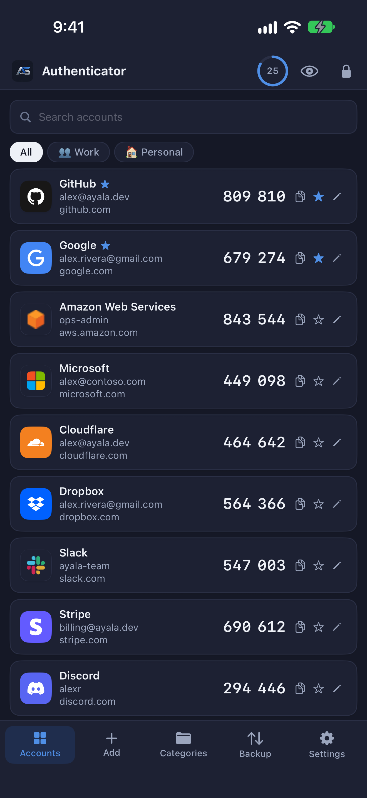
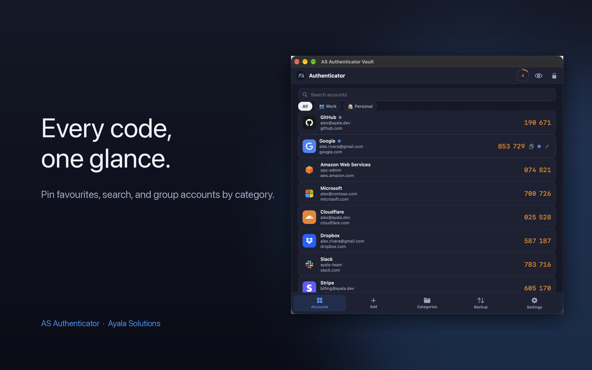

# AS Authenticator Vault

Two-factor codes, encrypted on your device and nowhere else. One native app for **iPhone, iPad and Mac**, by Ayala Solutions.

[Privacy policy](privacy) · [Support](support) · [Project page on GitHub](https://github.com/hov172/as-authenticator-vault) · [Browser extension guide](https://github.com/hov172/AS-Authenticator-Browser-Extensions)

&nbsp;

## On iPhone and iPad

- Codes appear above the keyboard through AutoFill, matched to the site you are signing in to
- Unlock with Face ID or Touch ID
- Scan a QR code with the camera, from a photo, or straight from Camera, Safari and Live Text
- Privacy screen in the app switcher, auto-lock the moment you leave

## On the Mac

- A menu bar extra with your codes one click away, ⌘L to lock, ⌘N to add, ⌘F to search
- Scan a QR code shown in any window or display, no screen-recording permission kept
- Unlock with Touch ID, lock when the screen locks or the Mac sits idle

## On both

- TOTP, HOTP and Steam Guard codes, with over 3,000 service logos offline
- One encrypted vault file, AES-256-GCM under an Argon2id key, shared with the browser extension
- Import from Google Authenticator, Aegis, 2FAS, Bitwarden and otpauth lists
- Five automatic local backups, a recovery code, and an export that opens anywhere the format is understood
- Optional sync between your devices through your own iCloud account, ciphertext only, off until you turn it on
- English, German, Spanish, French and Brazilian Portuguese

No account. No server. No analytics. The [privacy policy](privacy) is short because there is little to say.

Version 1.2 is in App Review for both platforms; the App Store link will be `https://apps.apple.com/app/id6821787531` once it is live.

© 2026 Ayala Solutions
